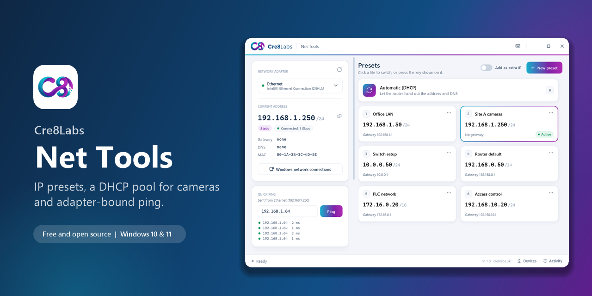
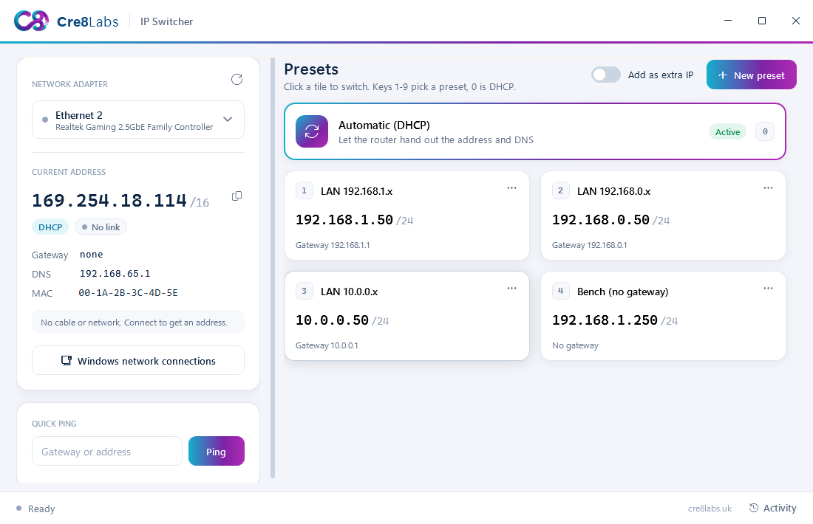
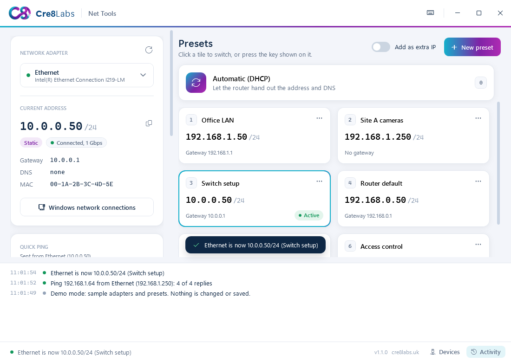
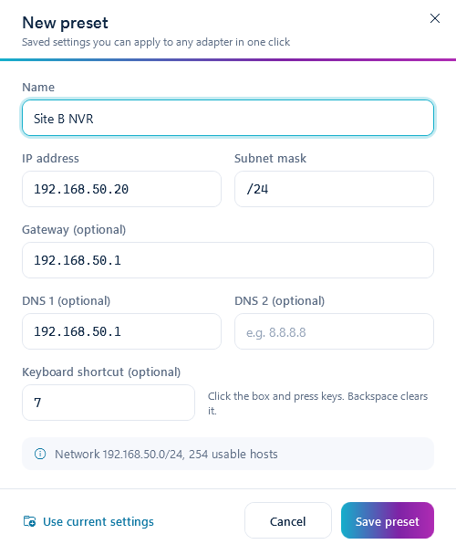

<p align="center">
  
</p>

<p align="center">
  <a href="https://github.com/Cre8LabsUK/cre8labs-ip-switcher/releases/latest"></a>
  <a href="https://github.com/Cre8LabsUK/cre8labs-ip-switcher/actions/workflows/build.yml"></a>
  <a href="https://github.com/Cre8LabsUK/cre8labs-ip-switcher/releases"></a>
  
  <a href="LICENSE"></a>
</p>

<p align="center">
  <a href="https://github.com/Cre8LabsUK/cre8labs-ip-switcher/releases/latest"><b>Download</b></a> ·
  <a href="#features">Features</a> ·
  <a href="#quick-start">Quick start</a> ·
  <a href="#faq">FAQ</a> ·
  <a href="#building-from-source">Build from source</a>
</p>

---

**Cre8Labs IP Switcher** saves the networks you work on as presets and switches your Windows network adapter between them with one click or one key press. It is built for engineers who plug into cameras, NVRs, access control panels, switches, PLCs and routers all day, and are tired of digging through five Control Panel dialogs to change a static IP.

<p align="center">
  
</p>

## Features

| | |
|---|---|
| **One-click presets** | IP, subnet mask, gateway and two DNS servers, applied in about a second |
| **Back to DHCP** | One click, or press `0` |
| **Your shortcuts** | Any key or combo per preset (default `1` to `9`, `0` for DHCP), turn them off, or make them work system-wide from the keyboard button in the title bar |
| **Live status** | Address, DHCP or static, link speed, gateway, DNS and MAC, updated as Windows reports changes |
| **Set up before you plug in** | Apply a preset with the cable unplugged; the saved settings are shown until the link comes up |
| **Add as extra IP** | Keep your current address and add a second one, to reach a device on another subnet |
| **Adapter-bound ping** | Pings always leave from the selected adapter, even when Wi-Fi or a VPN is on the same subnet |
| **Smart validation** | Live subnet summary, plus warnings for a gateway outside the subnet or a network or broadcast address |
| **Safe by design** | Undo for deleted presets, an activity log of every change, and no background services |
| **Portable mode** | Keep `presets.json` next to the exe and carry your presets on a USB stick |

<table>
  <tr>
    <td width="62%"></td>
    <td width="38%"></td>
  </tr>
  <tr>
    <td align="center"><sub>Switching networks, with the activity log open</sub></td>
    <td align="center"><sub>Preset editor with live subnet info</sub></td>
  </tr>
</table>

## Quick start

1. Download **`Cre8Labs-IPSwitcher-Setup-x.y.z.exe`** from the [latest release](https://github.com/Cre8LabsUK/cre8labs-ip-switcher/releases/latest) and run it.
2. Open **Cre8Labs IP Switcher** from the Start Menu and accept the administrator prompt. Windows only lets administrators change IP settings.
3. Pick your network adapter on the left. Wired Ethernet is selected first by default.
4. Click **New preset**, or press `Ctrl+N`, and save the networks you use.
5. Click a tile, or press its number, to switch.

Right-click a tile, or use its `...` button, to edit, duplicate, reorder or delete it.

### Downloads

| File | Use it when |
|---|---|
| `Cre8Labs-IPSwitcher-Setup-x.y.z.exe` | You want a normal install with a Start Menu shortcut and an uninstaller |
| `Cre8Labs-IPSwitcher-x.y.z-portable.exe` | You want a single exe with no install, for example on a USB stick |
| `SHA256SUMS.txt` | You want to verify a download with `Get-FileHash <file>` |

**Requirements:** Windows 10 (May 2019 update or later) or Windows 11, 64-bit or 32-bit. .NET Framework 4.8 is already part of these versions of Windows.

## FAQ

<details>
<summary><b>Windows SmartScreen says it "protected your PC". Is this safe?</b></summary>
<br>
The builds are not code-signed yet, so SmartScreen does not recognise them. Click <b>More info</b>, then <b>Run anyway</b>. Every release is built by GitHub Actions directly from the tagged source code, and you can compare your download with <code>SHA256SUMS.txt</code> on the release page.
</details>

<details>
<summary><b>Why does it need administrator rights?</b></summary>
<br>
Windows only allows administrators to change IP settings. The app asks once when it starts, so switching presets does not prompt you every time.
</details>

<details>
<summary><b>Where are my presets stored, and can I share them?</b></summary>
<br>

| Mode | Location |
|---|---|
| Installed | `%APPDATA%\Cre8Labs\IP Switcher\presets.json` |
| Portable | `presets.json` in the same folder as the exe (used whenever that file exists) |

The file is plain JSON, so you can back it up or hand it to your team:

```json
{
  "Adapter": "Ethernet",
  "Presets": [
    { "Name": "Site A cameras", "IP": "192.168.1.250", "Mask": "255.255.255.0", "Gateway": "", "DNS1": "", "DNS2": "" }
  ]
}
```

Uninstalling leaves your presets in place.
</details>

<details>
<summary><b>What does it actually change on my PC?</b></summary>
<br>
Only the IPv4 settings of the adapter you select. It uses Windows' own <code>netsh</code> tool from the system folder, for example:

```
netsh interface ipv4 set address name="Ethernet" source=static address=192.168.1.250 mask=255.255.255.0 gateway=none
netsh interface ipv4 set address name="Ethernet" source=dhcp
```

It installs no drivers or services, does not run in the background, does not update itself, and makes no network connections except the pings you start.
</details>

<details>
<summary><b>"Extra IPs need a static adapter". What does that mean?</b></summary>
<br>
Windows cannot mix DHCP with extra static addresses on the same adapter. Apply a static preset first, then turn on <b>Add as extra IP</b> and click the second preset.
</details>

## Building from source

You need the [.NET SDK](https://dotnet.microsoft.com/download) (any recent version) and, for the installer, [Inno Setup 6](https://jrsoftware.org/isinfo.php):

```powershell
winget install JRSoftware.InnoSetup
powershell -ExecutionPolicy Bypass -File build.ps1
```

The app, installer and checksums are written to `dist\`.

For UI work there is a read-only build that skips the administrator prompt, and a demo mode with sample adapters that never touches your network:

```powershell
dotnet build src -c Release -p:NoElevate=true -o preview-build
preview-build\Cre8Labs-IPSwitcher.exe --demo
```

| Path | What is in it |
|---|---|
| `src/Core/` | Networking, ping, IP maths and preset storage, with no UI code |
| `src/*.xaml` | Windows, styles and the Cre8Labs theme (`App.xaml`) |
| `installer/` | Inno Setup script and wizard artwork |
| `.github/workflows/` | CI build on every push, and releases when a `v*` tag is pushed |

### Releasing

Bump `<Version>` in `src/IPSwitcher.csproj`, add an entry to [`CHANGELOG.md`](CHANGELOG.md), then push a tag. GitHub Actions builds the installer and portable exe and publishes the release.

```powershell
git tag v1.1.0
git push origin v1.1.0
```

## Contributing

Bug reports, ideas and pull requests are welcome. Please read [CONTRIBUTING.md](CONTRIBUTING.md) first. To report a security problem privately, see [SECURITY.md](SECURITY.md).

## License

[MIT](LICENSE) © 2026 Cre8Labs. The Cre8Labs name and logo are trademarks of Cre8Labs and are not covered by the MIT license.

<p align="center">
  <a href="https://cre8labs.uk"></a><br>
  <sub>Made by <a href="https://cre8labs.uk">Cre8Labs</a></sub>
</p>
